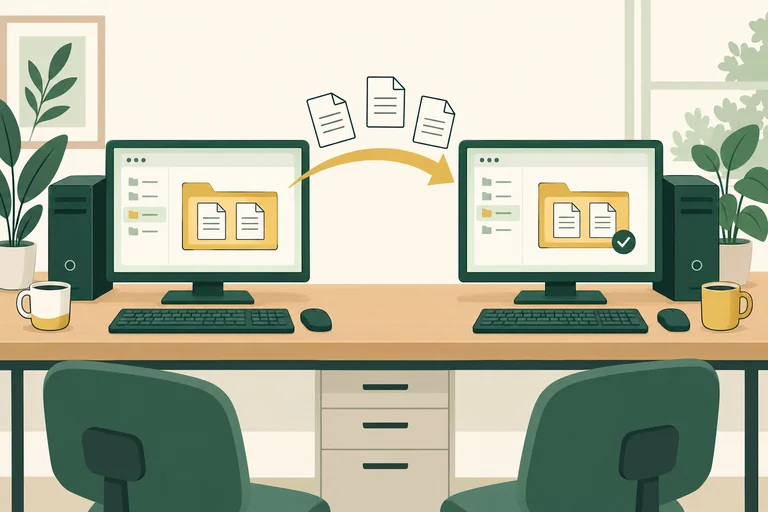

# PebblePaste by HandyPebble

**Copy across computers. Move your mouse. Keep going.**

Bring the computers on your desk closer together. Copy text, links, files,
and folders between Windows PCs and Intel Macs. Between Windows PCs, use one
keyboard and mouse, move your pointer across the screen edge, and keep working
on the next computer—with a little motion along the way.

## Download

**Public installers. Private application source. No GitHub account required.**

| Computer | Current version | Download |
| --- | --- | --- |
| Windows 10/11, x64 | 0.3.2 | [Download for Windows](https://github.com/adrovo-max/PebblePaste/releases/download/v0.3.2/PebblePaste-0.3.2-x64-setup.exe) |
| macOS, Intel processor | 0.2.3 | [Download for Intel Mac](https://github.com/adrovo-max/PebblePaste/releases/download/v0.3.2/PebblePaste-0.2.3-macOS-Intel.dmg) |

[Installation notes and checksums](https://github.com/adrovo-max/PebblePaste/releases/tag/v0.3.2)

The developer has confirmed Windows 0.3.2 and Intel Mac 0.2.3 working together
for cross-platform sharing in their own setup. The different version numbers
are intentional. A native Apple silicon package is not available.

## One keyboard. One mouse. More than one Windows PC.

Keep your hands where they are. Turn on **Keyboard & mouse** on both Windows
PCs, move your pointer across the screen edge, and continue using the next
computer with the same keyboard and mouse.

Mouse sharing currently uses the primary display. Seamless dragging between
computers and carrying a held key or mouse button across the edge are not
supported. To return control immediately, press **Ctrl+Alt+Shift+Esc** on the
controlling PC.

## Give screen crossing a little life

Make moving between Windows PCs feel more visible. Choose **Portal**,
**Ripple**, or **Particle Jump** under **Settings → Screen crossing effects**.
Adjust the intensity to suit your desk—or turn the effects off for a quieter
experience.

Try the local preview before connecting another computer. These effects mark
the screen crossing; they do not replace your desktop or require a new way
to work.

## Copy here. Paste there.

Copy text, a link, a file, or a folder on one computer. Paste it on another with
the shortcuts you already use: **Ctrl+C / Ctrl+V** on Windows and
**Command+C / Command+V** on Mac.

Use File Explorer or Finder for files and folders. Keep both computers
connected and sharing until copying finishes. With several computers, pair
each destination directly. A received item is not relayed through another
computer.

| Feature | Windows ↔ Windows | Windows ↔ Intel Mac / Intel Mac ↔ Intel Mac |
| --- | --- | --- |
| Text, links, files, and folders | Available | Available |
| Keyboard and mouse sharing | Available | Not included |
| Screen-crossing effects | Available | Not included |

## A few minutes to get connected

1. Install the appropriate package on each computer and join the same private Wi-Fi or Ethernet network.
2. Open PebblePaste, select the other computer, compare all six digits, and approve the connection on both screens.
3. Turn sharing on on both computers. Only new copies are shared.
4. For Windows keyboard and mouse sharing, enable **Keyboard & mouse** on both Windows PCs.

It is always a copy, never a move. Pause sharing before copying something you
do not want another connected computer to receive.

## Local connections, clear boundaries

Your copied items travel directly over encrypted connections between computers
you approve on your local network. No account or cloud file storage is needed.

Received files use a temporary local disk cache that is not encrypted at rest.
It is not a clipboard history. Keep PebblePaste running while using a received
selection. Interrupted transfers restart rather than resume halfway through a
file, and files already created at the destination may remain.

When Windows is involved, paths inside a selection must be shorter than 260
characters. Linked directories may be rejected instead of followed. Rich text,
clipboard images, phones, and Windows 7 are not supported.

## Install or update

Save your work and exit PebblePaste from its Windows system-tray or Mac menu-bar
menu before updating. Closing the window may only hide it.

- **Windows:** 220,974,438 bytes (about 210.74 MiB). Includes Microsoft's offline WebView2 installer.
- **Intel Mac:** 6,894,176 bytes (about 6.57 MiB). Open the disk image and move PebblePaste to Applications if prompted.

The Windows installer is unsigned. Do not disable Windows security. Keep
Gatekeeper enabled on Mac; a matching checksum does not replace a publisher
signature or Apple notarization. Ask your administrator before installing on a
managed computer.

The developer's cross-platform check does not establish compatibility with every
computer or network. Physical two-PC keyboard/mouse takeover and interaction
through effects have not been independently verified for this upload.

## Public downloads, private source

This repository is the official public product showcase. It contains product
information, release notes, and an illustration; installers are in **Releases**.

**The application source remains private. Proprietary software. All rights reserved.**

Choose the `.exe` or `.dmg` under **Assets**, not GitHub's automatic **Source
code** downloads. Those archives contain these public showcase files, not the
application source or installer.

[HandyPebble](https://handypebble.com/) ·
[Setup guide](https://handypebble.com/pebblepaste/copy/) ·
[Send feedback](https://handypebble.com/pebblepaste-feedback/) ·
[Release history](CHANGELOG.md) ·
[Security reporting](SECURITY.md) ·
[Rights notice](LICENSE-NOTICE.md)
